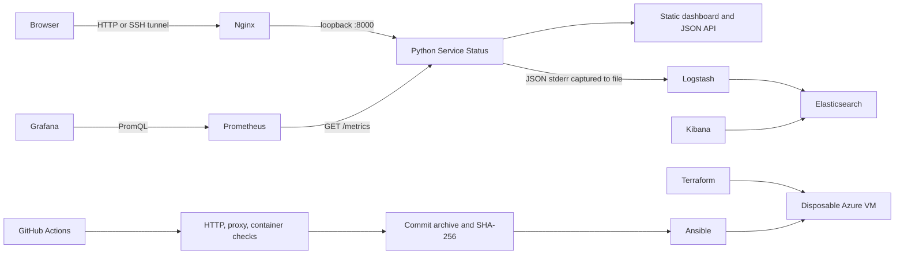

# Architecture and decisions

The diagram shows intended relationships. Monitoring and logging are optional local Compose labs; the VM does not automatically run them. Kubernetes/Helm is a separate local deployment path. Jenkins is an alternative build runner, not a dependency of GitHub Actions.

- **Small application:** standard-library Python keeps the learning focus on operations. This server remains a learning server; public production deployment needs a server and concurrency review, TLS, and operational load tests.
- **Health:** `/health` proves this process responds. There are no database or external dependency checks. Kubernetes uses the same endpoint for all probes because the app has no separate startup or readiness state.
- **Immutable releases:** an archive identifies a committed source revision and is verified before installation. A release-directory symlink allows explicit rollback. New uncommitted work does not appear in archives.
- **Bounded telemetry:** request counters use explicit routes plus `unknown`; queries and arbitrary URLs are excluded. A lock protects counters across request threads. Duration is measured on the server and excludes browser parsing; the browser's recent-check timing is different.
- **Conservative access:** Compose host ports and Nginx bind to loopback. Azure exposes only SSH from a configured administrator /32. Use a tunnel to reach the dashboard.
- **Separate lab stacks:** Elastic is resource-heavy and intentionally optional. Do not run it on the default small Azure VM.
- **Delivery runners:** GitHub Actions offers hosted disposable jobs. Jenkins requires maintaining the controller, plugins, agents, and Docker access. Its agent labeled `docker` must have Git, Python >=3.12, Bash, curl, and Docker; Nginx is needed to avoid skipped proxy tests. Configure a Pipeline from SCM using `Jenkinsfile`. A real Jenkins run is pending.

References: [Jenkins Pipeline](https://www.jenkins.io/doc/book/pipeline/jenkinsfile/), [Prometheus instrumentation](https://prometheus.io/docs/practices/instrumentation/), and [Logstash file input](https://www.elastic.co/guide/en/logstash/current/plugins-inputs-file.html).
